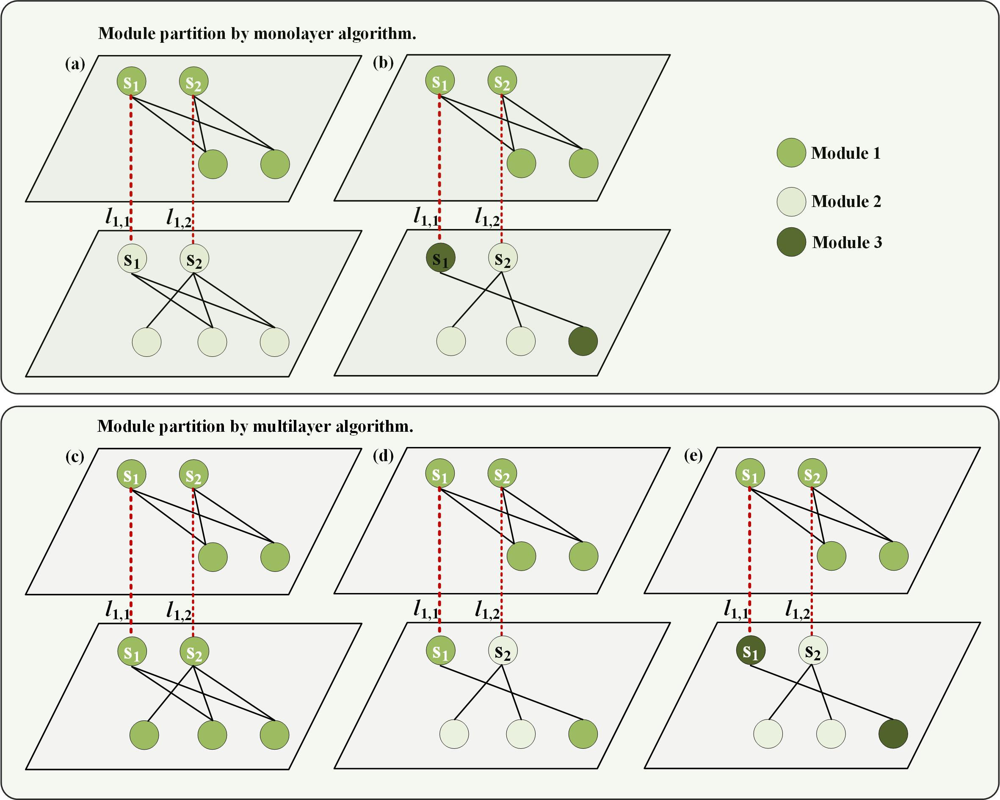

This respository contains all the code files used in this manuscript: "Introducing the Homo-Module Index to Quantify Cross-Layer Modular Alignment in Multilayer Ecological Networks".

## Core HMI workflow
<br>**Step 1: Prepare the network data** Organize the interaction data for each layer into a matrix and save each matrix as a .txt or .csv file.
<br>**Step 2: Detect modules**  Use the generalized Louvain algorithm in MATLAB to partition the network. We provide two partitioning schemes. In the monolayer scheme, each layer is partitioned independently. In the multilayer scheme, all layers are partitioned jointly. Both schemes return a module assignment for each node in each layer.
<br>**Step 3: Calculate HMI** Use the module assignments from Step 2 as input to the MATLAB implementation of HMI. 
These three steps constitute the workflow for calculating HMI. If the interaction matrices are already prepared, start at Step 2. If module assignments are already available, start at Step 3.

## Major functions
### **multilayer_module_partition (intra_data, inter_data, method, layer, iter, networktype, inter_links_type)**

**Description**
<br> This function performs module partition and calculates modularity for a multilayer network, based on GenLouvain method.

**Parameters**
<br>**intra_data** A three-dimensional array that represents the layers. Each layer is a matrix desribing intralayer interactions, and  rows should be matched across layers. 
<br>**inter_data** A matrix to represent interlayer links if considered (Rows indicate interlayers, columns indicate connector nodes,values indicate weights), or NaN otherwise.
<br>**method** The module partitioning approach ("multilayer" or "monolayer"). The "multilayer" algorithm performs module partition on all layer as a whole, while the "monolayer" algorithm performs module partition for each layer independently.
<br>**layer** The number of layers.
<br>**iter** The number of iterations for module partitioning.
<br>**networktype** The type of network within each layer ("bipartite" or "unipartite").
<br>**inter_links_type** The mode of interlayer links ("diagonal_coupling" or "multiplex").

**Value**
<br> Return a matrix indicating the module membership of connector nodes (rows indicate layers, column indicate connector nodes, and values indicate module membership) and the modularity metric (a value for multilayer algorithm and an average value for monolayer algorithm).

### **HomoMI (method, strategy, module_partition, inter_data)** 
**Description**
<br> This function calculates Homo-Module Index.

**Parameters**
<br>**method** The module partitioning approach ("multilayer" or "monolayer"). 
<br>**strategy** The criterion based on which the number of modules is determined, which can be maximum(max), minimum(min) or average(mean=(max+min)/2).
<br>**module_partition** A matrix indicating the module membership of connector nodes (rows indicate layers, column indicate connector nodes, and values indicate module membership)
<br>**inter_data** A matrix to represent interlayer links if considered (Rows indicate interlayers, columns indicate connector nodes,values indicate weights), or NaN otherwise.

**Value**
<br> Return the HMI value.

**Note**

HomoMI.m requires the following four functions to run successfully: find_max_connected_component.m, calculate_judge_matrix.m, generate_matrices.m, and generate_vector_sums.m.

## Examples of showing cross-layer module alignment and calculating HMI through a diagonally coupled toy network
------

```
%diagonal coupling network
%-----------------------------------------------------%
%module partition by monolayer algorithm
%without interlayer links weight
%Figure (a)
module_partition=[1 1;2 2]
HomoMI("monolayer",'mean',module_partition,NaN)

%module partition by monolayer algorithm
%without interlayer links weight
%Figure (b)
module_partition=[1 1;2 3]
HomoMI("monolayer",'mean',module_partition,NaN)

%module partition by multilayer algorithm
%without interlayer links weight
%Figure (c)
module_partition=[1 1;1 1]
HomoMI("multilayer",'mean',module_partition,NaN)

%module partition by multilayer algorithm
%without interlayer links weight
%Figure (d)
module_partition=[1 1;1 2]
HomoMI("multilayer",'mean',module_partition,NaN)

%module partition by multilayer algorithm
%without interlayer links weight
%Figure (e)
module_partition=[1 1;2 3]
HomoMI("multilayer",'mean',module_partition,NaN)
```

Schematic_Example1.m in the code folder is the example code for calculating the HMI of the diagonal coupling toy network (see Figure 1 in the main text of the manuscript).

## A worked example of calculating HMI
We showcase the calculation of HMI with an empirical weighted two-layer network of bird pollination and dispersal from Hervías-Parejo et al. (2020). This example uses bird pollination and dispersal data from San Cristobal(SC) Island.

### Step 1: Import data
```
layer = 2;
Intra_Data = cell(1,layer);
layer1 = importdata('SC_pollination.txt');
Intra_Data{1} = layer1.data;
layer2 = importdata('SC_SeedDispersal.txt');
Intra_Data{2} = layer2.data;

Inter_Data = importdata('inter_weight.txt');
Inter_Data = Inter_Data.data;
```
### Step 2: Calculate modularity and obtain module partition
Before calculating modularity and obtaining module partition, the GenLouvain function needs to be installed  (https://github.com/GenLouvain/GenLouvain). We provide GenLouvain2.0.zip in the Code folder. Extract the archive and add the extracted folder to the MATLAB search path.

We follow Pilosof et al.(2017) to modify the GenLouvain code by changing the null model Pijs, see **generate_monolayer_networks_supra_adjacency_matrix.m** (applicable to generating supra adjacency matrix in monolayer networks), **generate_multilayer_networks_supra_adjacency_matrix.m** (applicable to generating supra adjacency matrix in diagnol coupling networks) and **generate_multilayer_modularity_matrix.m** (applicable to generating supra adjacency matrix in bipartite multilayer networks or multiplex networks) in the code folder.
```
%module partition by monolayer algorithm
[modularity, module_partition] = multilayer_module_partition(Intra_data,Inter_data,"monolayer",layer,100,"bipartite","diagonal_coupling")
%module partition by multilayer algorithm
[modularity, module_partition] = multilayer_module_partition(Intra_data,Inter_data,"multilayer",layer,100,"bipartite","diagonal_coupling")
```
### Step 3: Calculate HMI
```
%module partition by monolayer algorithm
HMI=HomoMI("monolayer",'mean',module_partition,Inter_data)
%module partition by multilayer algorithm
HMI=HomoMI("multilayer",'mean',module_partition,Inter_data)
```

## Other functions to process data and analysis in the manuscript
## Reproducing the manuscript analyses
Generate the randomized networks using the null models described in the manuscript (<br> **NullModel_Intra_##.R**). For each randomized network, repeat Steps 2 and 3 to obtain module assignments, modularity scores, and HMI values (<br> **##_NullModel_Inter_HMI_Modularity.m, ##_NullModel_Intra_HMI_Modularity.m, ##_NullModel_Hybrid_HMI_Modularity.m**). The results of the null model are used to test whether the observed HMI differs from random expectation. Use the resulting null distributions to test whether the observed HMI differs from random expectations. The HMI and modularity values from these runs also serve as inputs to the statistical analyses in the manuscript (<br> **NullModel_HMI_MultiModularity_Analysis.R**).

## Additional scripts
- Infomap partitions. See aaaaa.R for an example of how to detect modules with Infomap and export the module assignments for HMI calculation.
- Simulated temporal networks. See bbbbb.m for the MATLAB code used to generate the simulated multilayer temporal networks.

## **References**
Hervías-Parejo S, Tur C,Heleno R, Nogales M, Timóteo S, Traveset A. 2020 Species functional traits and abundance as drivers of multiplex ecological networks:first empirical quantification of inter-layer edge weights. Proc. R. Soc. B 287: 20202127.
<br>Pilosof, S., M. A. Porter, M. Pascual, and S. Kéfi. 2017. The multilayer nature of ecological networks. Nature Ecology & Evolution 1:0101.
